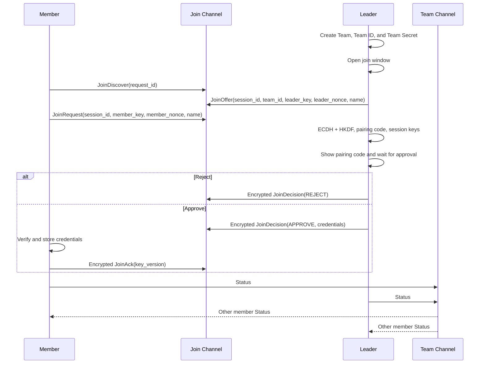

# Team Developer Guide

## 1. Design Principles

Team is a device-coordination protocol built on MeshCore group messages.

Goals:

- The Leader creates and manages a Team; a Member joins only after user approval.
- The Team key is never sent in cleartext during pairing.
- After pairing, the Team key protects member-state synchronization.
- Messages and runtime state use fixed-size embedded-friendly structures.

## 2. Roles

| Role | Responsibility |
|---|---|
| Leader | Creates the Team, opens the join window, approves members, publishes status |
| Member | Searches, selects a Team, submits a join request, publishes status |

A device belongs to one Team at a time. Changing role or leaving invalidates the previous session.

## 3. End-to-End Flow



## 4. Channels and Message Boundaries

| Channel | Purpose | Messages |
|---|---|---|
| Join Channel | Discovery and pairing | `0x10` to `0x14` |
| Team Channel | Post-pairing Team traffic | `0x01`, `0x03` |

All messages use MeshCore group data type `0xFF48`. Join messages use zero-hop transmission; Team status uses normal group transmission. Integers are little-endian.

## 5. Protocol Definition

### 5.1 Common Header

```text
version(1) | subtype(1)
```

The current version is `2`.

### 5.2 Pairing Messages

| Type | Direction | Fields |
|---|---|---|
| `0x10 JoinDiscover` | Member -> Leader | `request_id(4)` |
| `0x11 JoinOffer` | Leader -> Member | `request_id(4)`, `session_id(8)`, `team_id(8)`, `leader_public_key(32)`, `leader_nonce(16)`, `name_len(1)`, `name(0..31)` |
| `0x12 JoinRequest` | Member -> Leader | `session_id(8)`, `member_public_key(32)`, `member_nonce(16)`, `name_len(1)`, `name(0..31)` |
| `0x13 JoinDecision` | Leader -> Member | `session_id(8)`, `nonce(12)`, `cipher_len(1)`, `ciphertext`, `tag(16)` |
| `0x14 JoinAck` | Member -> Leader | `session_id(8)`, `nonce(12)`, `cipher_len(1)`, `ciphertext`, `tag(16)` |

### 5.3 Decision Plaintext

Reject:

```text
decision(1 = reject)
```

Approve:

```text
decision(1 = approve) | team_id(8) | key_version(4) |
team_secret(32) | name_len(1) | team_name | leader_public_key(32)
```

### 5.4 Ack Plaintext

```text
ack(1 = success) | key_version(4)
```

### 5.5 Status Messages

`0x01 Status` is sent periodically on the Team Channel:

```text
flags(1) | boot_id(2) | sequence(2) | public_key(32) |
battery_mv(2) | latitude_e6(4) | longitude_e6(4) |
fix_age_sec(2) | name_len(1) | name(0..31)
```

Flags:

| Bit | Meaning |
|---:|---|
| 0 | Leader |
| 1 | Battery valid |
| 4 | Location valid |

`0x03 SyncRequest` asks members to send Status in a response window:

```text
flags(1) | role(1) | sender_id(6) | boot_id(2) |
sequence(2) | request_id(2) | response_window_sec(1)
```

### 5.6 Encoding and Length Rules

| Field | Encoding / range |
|---|---|
| `version` | 1 byte, must be `2` |
| `subtype` | 1 byte, unknown values are discarded |
| `request_id` | 4-byte random value |
| `session_id` | 8-byte random value, never zero |
| `team_id` | Non-zero 8-byte identifier |
| `public_key` | 32-byte device public key |
| `nonce` | 12-byte AEAD nonce, unique per frame |
| `name_len` | 0-31; exactly that many UTF-8 bytes must follow |
| Coordinates | Latitude `-90,000,000..90,000,000`; longitude `-180,000,000..180,000,000` |
| `cipher_len` | Must match the ciphertext length and contain at least one plaintext byte |

Parsing order is: check the minimum length, check version and subtype, check variable-field lengths, then perform UTF-8, range, and cryptographic authentication checks. Any failure must leave member state unchanged.

### 5.7 Encrypted Frame Format

```text
version(1) | subtype(1) | session_id(8) | nonce(12) |
cipher_len(1) | ciphertext(cipher_len) | tag(16)
```

The AEAD additional authenticated data (AAD) for Decision and Ack is:

```text
transcript_hash(32) | subtype(1) | direction(1)
```

`direction=0` means Leader to Member; `direction=1` means Member to Leader. Decision uses the Decision key and Ack uses the Ack key.

### 5.8 Receive Processing Order

1. Filter by channel and data type.
2. Check `version`, `subtype`, and total length.
3. Check that session/request IDs and the current state match.
4. Derive keys from both public keys and nonces.
5. Verify AEAD; discard immediately on failure.
6. Validate plaintext fields and relationships such as Team ID, Leader key, and key version.
7. Update credentials or the member table only after every check passes.

## 6. Security and State Rules

1. Both sides perform ECDH with device identity keys.
2. The transcript contains the version, session/Team identifiers, both public keys, and both nonces.
3. HKDF-SHA256 derives the Decision and Ack keys.
4. Decision and Ack use ChaCha20-Poly1305; authentication failure discards the message.
5. The Member stores credentials only after validating the Team ID, Leader key, and AEAD tag.
6. Status freshness uses `(boot_id, sequence)`; old messages cannot overwrite newer state.
7. Timeout, window closure, or cancellation clears ephemeral state and keys.
8. Core Team credentials are `team_id`, `key_version`, `team_secret`, and `leader_public_key`.

## 7. Development Rules

- Do not use dynamic containers for members or pairing sessions; capacity is compile-time bounded.
- Validate version, type, length, UTF-8, coordinate range, and authentication before accepting input.
- Allocate a new subtype for every new message and preserve compatibility for existing subtypes.
