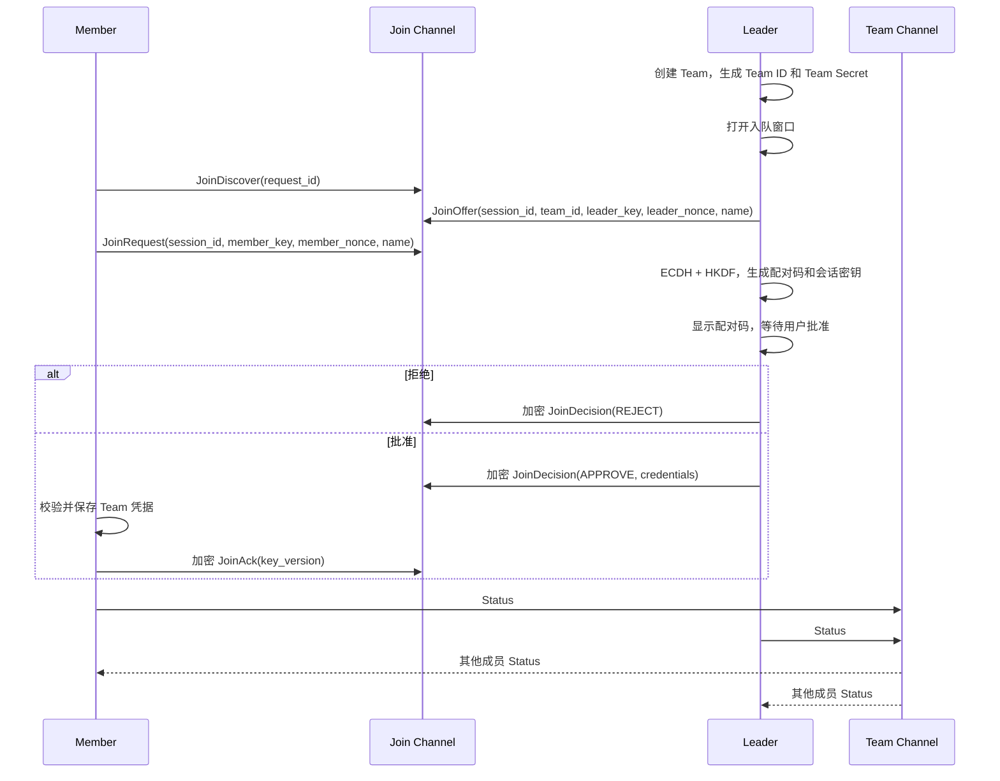

# Team 开发手册

## 1. 设计思想

Team 是建立在 MeshCore 群组消息之上的设备协作协议。

设计目标：

- Leader 负责创建和管理 Team，Member 通过人工确认加入。
- 入队阶段不明文传输 Team 密钥。
- 入队完成后使用 Team 密钥进行成员状态同步。
- 协议使用固定长度字段和固定内存状态，适合嵌入式设备。

## 2. 角色

| 角色 | 职责 |
|---|---|
| Leader | 创建 Team、打开入队窗口、审批成员、发送周期状态 |
| Member | 搜索 Team、选择目标、提交入队请求、发送周期状态 |

一个设备同一时间只能属于一个 Team。切换角色或离开 Team 后，原 Team 会话失效。

## 3. 端到端流程



## 4. 信道和消息边界

| 信道 | 用途 | 消息 |
|---|---|---|
| Join Channel | 发现和入队 | `0x10` 到 `0x14` |
| Team Channel | 入队后的 Team 通信 | `0x01`、`0x03` |

所有消息使用 MeshCore 群组数据类型 `0xFF48`。Join 消息使用零跳发送，Team 状态使用普通群组发送。整数使用小端序。

## 5. 协议定义

### 5.1 通用头

```text
version(1) | subtype(1)
```

当前 `version = 2`。

### 5.2 入队消息

| 类型 | 方向 | 字段 |
|---|---|---|
| `0x10 JoinDiscover` | Member -> Leader | `request_id(4)` |
| `0x11 JoinOffer` | Leader -> Member | `request_id(4)`, `session_id(8)`, `team_id(8)`, `leader_public_key(32)`, `leader_nonce(16)`, `name_len(1)`, `name(0..31)` |
| `0x12 JoinRequest` | Member -> Leader | `session_id(8)`, `member_public_key(32)`, `member_nonce(16)`, `name_len(1)`, `name(0..31)` |
| `0x13 JoinDecision` | Leader -> Member | `session_id(8)`, `nonce(12)`, `cipher_len(1)`, `ciphertext`, `tag(16)` |
| `0x14 JoinAck` | Member -> Leader | `session_id(8)`, `nonce(12)`, `cipher_len(1)`, `ciphertext`, `tag(16)` |

### 5.3 Decision 明文

拒绝：

```text
decision(1 = reject)
```

批准：

```text
decision(1 = approve) | team_id(8) | key_version(4) |
team_secret(32) | name_len(1) | team_name | leader_public_key(32)
```

### 5.4 Ack 明文

```text
ack(1 = success) | key_version(4)
```

### 5.5 状态消息

`0x01 Status` 在 Team Channel 中周期发送：

```text
flags(1) | boot_id(2) | sequence(2) | public_key(32) |
battery_mv(2) | latitude_e6(4) | longitude_e6(4) |
fix_age_sec(2) | name_len(1) | name(0..31)
```

Flags：

| 位 | 含义 |
|---:|---|
| 0 | Leader |
| 1 | 电池有效 |
| 4 | 位置有效 |

`0x03 SyncRequest` 用于请求成员在指定窗口内补发 Status：

```text
flags(1) | role(1) | sender_id(6) | boot_id(2) |
sequence(2) | request_id(2) | response_window_sec(1)
```

### 5.6 字段编码和长度

| 字段 | 编码/范围 |
|---|---|
| `version` | 1 字节，必须为 `2` |
| `subtype` | 1 字节，未知值丢弃 |
| `request_id` | 4 字节随机值 |
| `session_id` | 8 字节随机值，不能为 0 |
| `team_id` | 8 字节非 0 标识 |
| `public_key` | 32 字节设备公钥 |
| `nonce` | 12 字节 AEAD 随机数，每帧唯一 |
| `name_len` | 0 到 31，后面必须有完全相同长度的 UTF-8 数据 |
| 坐标 | 纬度 `-90,000,000..90,000,000`；经度 `-180,000,000..180,000,000` |
| `cipher_len` | 必须与实际密文长度一致，且包含至少 1 字节明文 |

解析顺序必须是：先检查最小长度，再检查版本和子类型，再检查变长字段长度，最后执行 UTF-8、范围和密码认证校验。任何一步失败都不得更新成员状态。

### 5.7 加密帧格式

```text
version(1) | subtype(1) | session_id(8) | nonce(12) |
cipher_len(1) | ciphertext(cipher_len) | tag(16)
```

Decision 和 Ack 的 AEAD 附加认证数据（AAD）为：

```text
transcript_hash(32) | subtype(1) | direction(1)
```

`direction=0` 表示 Leader 到 Member，`direction=1` 表示 Member 到 Leader。Decision 使用 Decision key，Ack 使用 Ack key。

### 5.8 接收处理顺序

1. 按信道和数据类型过滤。
2. 检查 `version`、`subtype` 和总长度。
3. 检查会话编号、请求编号和当前状态是否匹配。
4. 根据双方公钥和随机数派生密钥。
5. 校验 AEAD；失败立即丢弃。
6. 校验明文字段和业务关系，例如 Team ID、Leader 公钥、密钥版本。
7. 通过全部检查后，才写入凭据或更新成员表。

## 6. 安全和状态规则

1. 双方使用设备身份密钥执行 ECDH。
2. Transcript 由版本、会话/Team 标识、双方公钥和双方随机数组成。
3. 使用 HKDF-SHA256 派生 Decision key 和 Ack key。
4. Decision、Ack 使用 ChaCha20-Poly1305；校验失败必须丢弃。
5. Member 只有在校验 Team ID、Leader 公钥和 AEAD 成功后才能保存凭据。
6. Status 使用 `(boot_id, sequence)` 判断新旧，旧消息不能覆盖新状态。
7. 入队会话超时、入队窗口关闭或用户取消时，临时状态和密钥必须清除。
8. Team 凭据的核心字段为 `team_id`、`key_version`、`team_secret`、`leader_public_key`。

## 7. 开发约束

- 不使用动态容器保存成员和入队会话；容量由编译期配置决定。
- 所有输入必须检查版本、类型、长度、UTF-8、坐标范围和密文认证结果。
- 新增消息必须分配新的 subtype，并保持旧 subtype 的字段兼容性。
